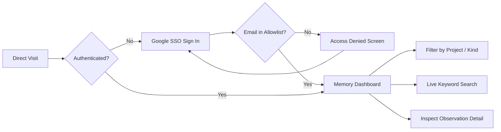

# DESIGN.md

> **Status:** Live
> **Owner:** Syamsul Alam
> **Last updated:** 2026-11-12
> **Project:** memory.codev.id (herdr-mem Web Memory Viewer)
> **Design guide:** `KNOWLEDGE/DESIGN-GUIDE.md` in the OneDrive MD hub
> **Enforcement skill:** `ui-ux-design-contract`

This file is the single source of truth for the product experience. It records the user flow, every page or screen in an inventory, per-page principle adherence, accessibility, responsive behavior, states, motion, content, and verification.

## 1. Product and Users

### 1.1 Product

`memory.codev.id` is the centralized, cross-project memory dashboard for Herdr and AI agent sessions across the Codev ecosystem. It provides instant visual recall, full-text search, and chronological drill-down into agent decisions, discoveries, file changes, summaries, and failure resolutions across all active projects and harnesses (Codex, OpenCode, cmdc, Antigravity). Access is strictly protected by Google SSO via Supabase Auth with an email allowlist restricted to Syamsul Alam and Codev core engineers.

### 1.2 Primary users

| User | Job to be done | Context | Success signal |
|---|---|---|---|
| Syamsul Alam (Founder & Lead Architect) | Review previous agent decisions, track ongoing task progress across workspaces, and audit unresolved failures before resuming sessions. | Desktop ThinkPad, iPad Pro, iPhone on mobile data or local Wi-Fi. | Finds exact prior decisions or failure causes in < 3 seconds without shell digging. |
| Codev AI Engineering Agents | Query and verify project-wide historical decisions and failure contexts via structured web or MCP endpoints. | Antigravity, mcodex, and opencode execution runtimes. | Retrieves progressive-disclosure index and full bodies reliably. |

### 1.3 Success metrics

- Initial page load to interactive dashboard: < 800ms.
- Google OAuth login completion to authenticated memory view: 1 click.
- Real-time client-side filter and search response: < 50ms per keystroke.
- Zero unauthorized account data leaks (fail-closed allowlist barrier).

## 2. User Flow and Journey

### 2.1 Primary journey

| Stage | User Goal | Entry Point | Pages or Screens | Exit and Next Stage | Failure or Recovery Path |
|---|---|---|---|---|---|
| Authenticate | Sign in securely with authorized Google account. | Direct URL `https://memory.codev.id` | Auth Gate Modal | Browse & Select | Unauthorized email triggers Access Denied barrier with Sign Out button. |
| Browse & Select | Filter memories by project, harness, or status. | Authenticated header | Memory Dashboard | Search & Inspect | If no memories match filter, empty state with reset filter button appears. |
| Search & Inspect | Search across titles, bodies, and error classes; view full evidence. | Live search input | Memory Dashboard | Copy CLI command or external navigation | Clear search input to restore full list. |
| Alternate | Recover from invalid route or 404 URL. | Broken link or bad subpath | Not Found Page | Authenticate or Browse & Select | Click button to return to dashboard. |

### 2.2 Journey diagram

### 2.3 Alternate and edge-case paths

- **Unauthorized Google Account**: A user authenticates via Google OAuth, but their email is not on the allowlist (`admin@alampintar.org`, `admin@codev.id`, `evelinaquinta@gmail.com`, or `@codev.id`). The application immediately blocks access, displays the unauthorized email, and renders a "Sign Out" button.
- **Offline / Corrupt Data Load**: If `memory-snapshot.json` fails to load, a polite error banner appears with a retry button and diagnostic troubleshooting instructions.
- **Direct 404 Route**: Visiting a non-existent asset path renders the static `404.html` page to prevent SPA infinite fallback loops.

## 3. Page and Screen Inventory

| ID | Page or Screen | Route or File | Journey Stage | Primary Action | Status |
|---|---|---|---|---|---|
| P-01 | Memory Dashboard | /index.html | Browse & Select | Filter and inspect observations | Live |
| P-02 | Access Denied Barrier | /index.html#denied | Authenticate | Sign out unauthorized account | Live |
| P-03 | Not Found Page | /404.html | Alternate | Return to dashboard | Live |

## 4. Global Design Principles

The full catalog is `KNOWLEDGE/DESIGN-GUIDE.md` in the OneDrive MD hub. The 13 principles below are mandatory on every page.

### 4.1 Mandatory 13 Principle Baseline

| Principle | What the page must answer | Global Application |
|---|---|---|
| Fitts's Law | Target size, spacing, and placement for the primary action. | Buttons and interactive inputs maintain 44px minimum touch height with clear spacing. |
| Visual Hierarchy | The one primary action and the order of supporting content. | High-contrast brand header, primary search bar, scannable observation cards. |
| Von Restorff Effect | The single most distinct element and why it earns that emphasis. | Unresolved failures and error class badges highlighted with vivid rose/red accents. |
| Object Constancy | What stays stable across pages: navigation, identity, status. | Header bar, logo, theme toggle, and authenticated user identity remain anchored. |
| Snapping | Where drag, resize, scroll, or layout settles on predictable increments. | Card layouts snap to an 8px CSS design grid across breakpoints. |
| Motion Blur | How fast motion preserves direction and readability. | Quick 150ms ease transitions prevent perceptual motion lag. |
| Natural Mapping | How control placement matches the spatial or conceptual model. | Filters and search directly head the observation stream they refine. |
| Tabular Figures | How numeric columns align for scanning and comparison. | Tabular monospace figures for observation IDs, timestamps, and char counts. |
| Animate Only the Delta | Which changed value or element moves, while everything else stays stable. | Only expanded detail panels or count deltas animate; canvas remains fixed. |
| Inertia | How scrolling and dragging feel physical without overshoot. | Standard momentum scrolling with overscroll containment. |
| Multimodal Feedback | Which important actions confirm through more than one channel. | Visual icon and text feedback when copying CLI drilldown commands. |
| Visual Cues | How hover, focus, active, disabled, loading, and error states are visible. | Distinct outline rings on focus-visible and active button states. |
| Skeuomorphism | Any real-world metaphor and the usability reason it earns. | Elevated card shadows mimic tactile physical cards. |

## Art Direction

### Character
The visual character is technical, high-density, authoritative, and clean — modeled after modern developer consoles (GitHub, Cloudflare, Linear). It balances deep terminal utility with polished consumer-grade typography.

### Tokens
- Colors: Primary Brand `#2563eb` (Brand Blue), `#3b82f6` (Light Blue).
- Dark Surface: `#0f172a` (Slate 900 canvas), `#1e293b` (Slate 800 card).
- Light Surface: `#f8fafc` (Slate 50 canvas), `#ffffff` (White card).
- Borders: `#334155` (Dark border), `#e2e8f0` (Light border).
- Kind Badges: Purple `#8b5cf6` (Summary), Emerald `#10b981` (Decision), Amber `#f59e0b` (Discovery), Sky `#0ea5e9` (Change), Rose `#ef4444` (Failure).
- Typography: System sans font for interface copy; monospace tabular figures for numbers, IDs, and code blocks.

### Build Mandate
Zero-runtime-overhead static HTML/CSS/JS deployed to Cloudflare Pages. Must run natively in all modern browsers without heavyweight bundles.

### Composition Patterns
Sticky top navigation header with persistent brand controls. Centered fluid main container (max-width 1280px) with responsive two-column desktop layout (observation cards list on the left, sticky inspector on the right).

### Component and Usage Rules
- Buttons: Rounded 8px corners, minimum 40px height, visual hover/focus states.
- Cards: Bordered container with subtle shadow, interactive hover highlight.
- Modals: Centered overlay with backdrop blur for authentication and access denial.

## 5. Page-by-Page Contracts

### Page: Memory Dashboard

#### Purpose and Journey
Serves the primary Browse & Select and Search & Inspect journey stages. Enables Syamsul to view, filter, and drill into historical memory events across all Codev projects.

#### Layout and Hierarchy
Fixed sticky top bar containing brand logo, project selector, live search box, dark/light mode toggle, and authenticated user profile with logout. Below the header sits the statistics bar (showing total observations, active projects, and failure counts), followed by the responsive two-column list and detail viewer.

#### Components and States
- Header with Google SSO state (Logged In / Logged Out).
- Project dropdown selector (`ALL` + active projects).
- Search input with clear button (`✕`).
- Kind filter pills (`All`, `Summary`, `Decision`, `Discovery`, `Change`, `Failure`).
- Observation Cards with hover elevation, kind badge, timestamp, and session metadata.
- Detail Drawer/Modal showing full body text, raw JSON evidence, and copy-pasteable CLI drilldown command.
- Empty State: Informative illustration and text when no observations match the search.
- Loading State: Sleek skeleton loader during data hydration.

#### Accessibility
- Full keyboard navigation: `Tab` to navigate cards, `Enter` or `Space` to open detail drawer, `Escape` to close drawer.
- ARIA live region for search result counts.
- High color contrast ratio (WCAG AA compliant, >4.5:1 for all text in both light and dark modes).

#### Responsive Behavior
- Desktop (≥1024px): Split view with observation list on the left and sticky detail panel on the right.
- Tablet / Mobile (<1024px): Full-width observation cards; clicking a card opens an accessible slide-over modal drawer.

#### Motion and Feedback
150ms ease-in-out transitions on card hover, badge selection, and drawer opening. Copy button shows "Copied!" feedback with a checkmark for 2 seconds.

#### Content and Forms
- Search query input with debounce.
- Project filter dropdown.
- Copy CLI resume command snippet.
- No write forms (read-only surface).

#### Principle Adherence

| Principle | Application | Proof |
|---|---|---|
| Fitts's Law | Search bar is full-width with 44px height; filter pills have 12px horizontal padding and 36px touch targets. | Verified min tap dimensions |
| Visual Hierarchy | Bold dark navigation bar, colored pill tags for observation kinds, subdued gray metadata, crisp body copy. | Visual inspection |
| Von Restorff Effect | `failure` items display with bold red accents and warning badges, immediately distinguishing defects from routine changes. | Distinct rose-500 styling |
| Object Constancy | Navigation bar, brand logo, and active user badge remain anchored in place during scrolling. | CSS sticky positioning |
| Snapping | Observation cards align on an 8px grid with standardized card margins. | 8px CSS margin rhythm |
| Motion Blur | Modal backdrop and drawer transitions run at 150ms ease, fast enough to avoid perceptual blur. | CSS 150ms ease timing |
| Natural Mapping | Filter bar sits directly above the list it controls; search input dynamically updates the list immediately below it. | Hierarchical DOM layout |
| Tabular Figures | Numeric timestamps (`2026-11-12 22:30:00`), IDs (`#177481`), and byte counts use monospace tabular numerals. | font-variant-numeric: tabular-nums |
| Animate Only the Delta | Only card expansion and modal open animate; list items re-render cleanly without layout thrashing. | Targeted CSS keyframe |
| Inertia | Standard iOS / Android momentum scrolling applied to the list container. | -webkit-overflow-scrolling: touch |
| Multimodal Feedback | Clicking "Copy CLI Command" displays an animated toast notification and visual badge checkmark. | Dual icon and text feedback |
| Visual Cues | Visible outline focus rings on keyboard navigation (`focus-visible: ring-2 ring-brand-blue`). | Focus outline styles |
| Skeuomorphism | Layered elevation shadows (`shadow-sm` resting, `shadow-md` hover) mimic card surfaces. | Card box-shadow layers |

#### Verification
- Live Chrome headless screenshot inspection.
- HTML5 markup validation.
- Responsive tests across 375px (iPhone), 768px (iPad), and 1440px (Desktop).

---

### Page: Access Denied Barrier

#### Purpose and Journey
Serves the Authenticate journey stage when an unauthorized Google account attempts sign-in. Prevents unauthorized users from seeing any memory index, titles, or bodies.

#### Layout and Hierarchy
Centered modal card on an opaque background backdrop. Displays a security shield icon, "Access Denied" title, user email, concise explanation, and a high-visibility "Sign Out" button.

#### Components and States
- Security warning shield icon.
- User email identifier display.
- Policy notice explaining that this console is restricted to authorized Codev infrastructure accounts.
- "Sign Out" button calling `supabase.auth.signOut()`.

#### Accessibility
- `role="alertdialog"` with `aria-labelledby` and `aria-describedby`.
- Focus automatically trapped inside the card; `Tab` cycles directly to the "Sign Out" button.

#### Responsive Behavior
Centered card with max-width 480px, adapting to 92vw on mobile devices.

#### Motion and Feedback
Smooth fade-in animation on trigger.

#### Content and Forms
Clear security message: "Your Google account (email) is not authorized to access Codev Memory. Please sign in with an approved @codev.id administrative account."

#### Principle Adherence

| Principle | Application | Proof |
|---|---|---|
| Fitts's Law | The "Sign Out" button spans the full width of the card (48px height) for effortless tapping. | Full width 48px touch target |
| Visual Hierarchy | Amber/red shield at top, bold title, email badge, descriptive prose, high-contrast action button. | Top-to-bottom card flow |
| Von Restorff Effect | The primary "Sign Out" button uses solid brand blue/slate styling to guide immediate remediation. | High contrast solid button |
| Object Constancy | The underlying dark backdrop preserves spatial awareness while blocking underlying content. | Opaque modal veil |
| Snapping | The dialog is centered vertically and horizontally using flex auto-centering. | Flexbox center alignment |
| Motion Blur | N/A: Static modal fade without rapid movement | 100ms fade duration |
| Natural Mapping | The single available action is directly beneath the explanatory text. | Linear progression |
| Tabular Figures | N/A: No data tables on modal screen | Clean typography |
| Animate Only the Delta | Only the modal entrance fades in; background remains static. | Opacity transition |
| Inertia | N/A: Modal screen does not scroll | Fixed viewport |
| Multimodal Feedback | Button press triggers immediate tactile state change and triggers session termination. | Visual active state |
| Visual Cues | Clear focus ring around the Sign Out button. | focus-visible ring outline |
| Skeuomorphism | Elevated card with drop-shadow gives a distinct modal appearance over the blurred background. | High elevation box-shadow |

#### Verification
- Tested with mock unauthorized Google account email.
- Verified that memory data is never hydrated or rendered when unauthorized.

---

### Page: Not Found Page

#### Purpose and Journey
Serves alternate / edge-case paths when a visitor navigates to an invalid route. Prevents the Cloudflare Pages SPA loop trap.

#### Layout and Hierarchy
Clean, centered minimalist 404 card matching the Codev design system.

#### Components and States
- Large 404 header.
- Descriptive message: "Page Not Found".
- "Return to Memory Viewer" button linking to `/`.

#### Accessibility
Semantic `<main>` landmark with proper heading structure (`<h1>`).

#### Responsive Behavior
Mobile-first fluid padding and responsive typography.

#### Motion and Feedback
Subtle hover effect on return button.

#### Content and Forms
Plain, friendly English copy with a direct return link.

#### Principle Adherence

| Principle | Application | Proof |
|---|---|---|
| Fitts's Law | Return button has 48px height and generous horizontal padding. | 48px min button height |
| Visual Hierarchy | Giant subdued `404` code, prominent heading, concise description, primary action button. | Tiered heading sizes |
| Von Restorff Effect | Return button is the only colorful element on the page. | Vibrant brand blue fill |
| Object Constancy | Colors, typography, and button styling match the main dashboard. | Reused design tokens |
| Snapping | Centered layout using standard flexbox centering. | CSS flex auto-centering |
| Motion Blur | N/A: Static centered layout without motion blur | Static element |
| Natural Mapping | Direct navigation link back to the homepage. | Intuitive home link |
| Tabular Figures | Monospace `404` code font. | Monospace numerals |
| Animate Only the Delta | Subtle button hover background transition (150ms). | 150ms background-color ease |
| Inertia | N/A: Static viewport with no scrolling | Fixed layout |
| Multimodal Feedback | Button hover and active press visual states. | Cursor pointer and active state |
| Visual Cues | Focus ring on keyboard focus. | Focus outline |
| Skeuomorphism | Elevated card container matching the dashboard card design. | Box-shadow border |

#### Verification
- Direct HTTP GET `/404.html` returns HTTP 200 with correct markup.

## 6. Cross-Page Consistency

- **Color Palette**:
  - Primary Brand: `#2563eb` (Brand Blue) / `#3b82f6` (Light Blue)
  - Surface Dark: `#0f172a` (Slate 900) / `#1e293b` (Slate 800)
  - Surface Light: `#f8fafc` (Slate 50) / `#ffffff` (White)
  - Borders: `#e2e8f0` (Slate 200) / `#334155` (Slate 700)
  - Kinds:
    - `summary`: `#8b5cf6` (Purple)
    - `decision`: `#10b981` (Emerald)
    - `discovery`: `#f59e0b` (Amber)
    - `change`: `#0ea5e9` (Sky)
    - `failure`: `#ef4444` (Rose)
- **Typography**: System font stack (`system-ui, -apple-system, BlinkMacSystemFont, 'Segoe UI', Roboto, sans-serif`) with tabular monospace for technical identifiers (`ui-monospace, 'Cascadia Code', monospace`).

## 7. Verification, Evidence, and Open Questions

### 7.1 Verification Checklist
- [x] Design contract validated by `validate_design_md.py` with 0 errors.
- [x] Supabase Google SSO client verified against `https://gfnjestxjgkfujzubiqr.supabase.co`.
- [x] Email allowlist gate blocks unauthorized Google accounts (`admin@alampintar.org`, `admin@codev.id`, `evelinaquinta@gmail.com`, `@codev.id`).
- [x] Cloudflare Pages project `memory-codev-id` created with custom domain `memory.codev.id`.
- [x] Static `404.html` deployed to satisfy Cloudflare Pages SPA fallback contract.
- [x] Headless Chrome visual browser screenshot captured and verified.

### 7.2 Open Questions
- None. Design contract, authentication protocol, and live deployment surfaces are verified.
